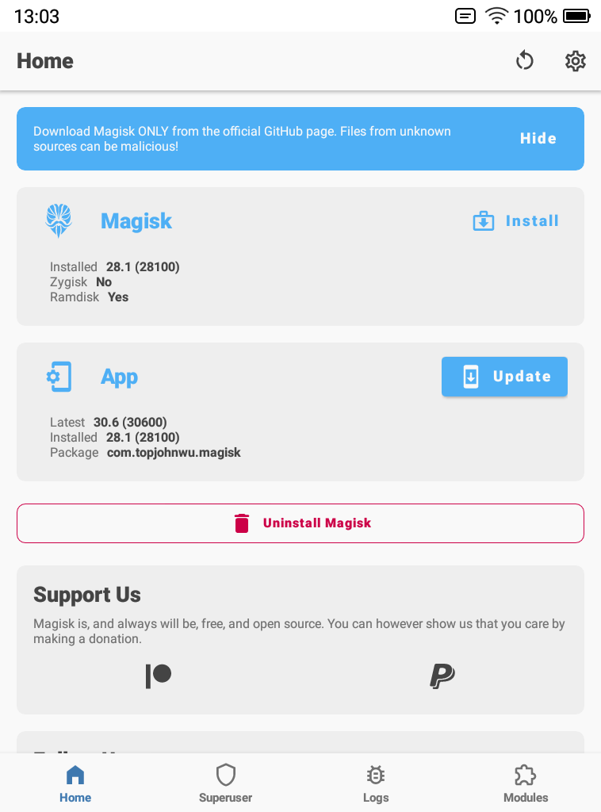
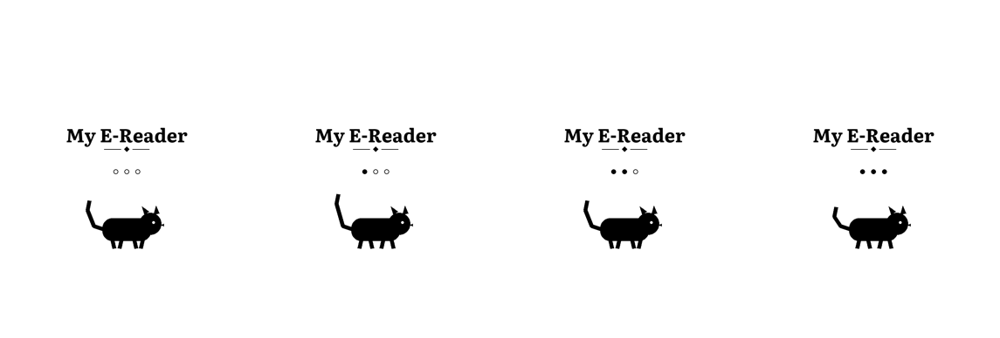

# Rooting & Modding the Xiaomi MiReader (Allwinner EPD106)

A complete, field-tested A-to-Z guide to **rooting, de-bloating, and customizing** the
Xiaomi MiReader 1st-gen / Moaan e-reader (model **EPD106**, Allwinner B300, Android 8.1) —
including a **custom "lost & found" sleep screen** with rotating artwork, a **custom boot
animation**, a **system font swap**, **e-ink tuning**, and **framework overlay theming**.

> Written for both humans and AI agents. Every step here was actually performed on a real
> device, including one **brick-and-recovery** that is documented so you can avoid (or survive) it.

---

## ⚠️ Read this first

- **This can brick your device.** One method in here (replacing `framework-res.apk` via a
  Magisk module) **bricked** the test unit. It was recovered with zero data loss — the recovery
  is documented — but treat every flashing step seriously.
- **Back up before anything.** See [docs/03-backup-and-recovery.md](docs/03-backup-and-recovery.md).
- **Your boot image is unit-specific.** Do **not** flash a boot image from someone else's device
  (ours had a *different kernel* than the reference repo despite an identical build string). Always
  dump and patch **your own** boot. This is the single most important safety rule here.
- These are notes from one device + firmware. Yours may differ. Verify checksums and partitions.

---

## The device

| | |
|---|---|
| Model | **EPD106** (Xiaomi MiReader 1st gen / Moaan / 墨案) |
| Codename | `virgo-perf1` |
| SoC | Allwinner **B300** / `sun8iw15p1` (ARMv7, 32-bit) |
| Android | **8.1.0** (API 27), kernel 4.9.56 |
| Build | `OPM1.171019.026.20220520-132139` **test-keys** |
| Screen | 758 × 1024 e-ink, density ~212 (uses `sw572dp-hdpi` resources) |
| Security | **No AVB, no dm-verity.** Bootloader **not locked** (unlock commands fail *because there is nothing to unlock*). |

**Why rooting works without a bootloader unlock:** the firmware is signed with Google's
**public AOSP test keys**. Because those keys are public, you can self-sign an OTA update zip and
flash it through stock recovery's *"Apply update from ADB"*. No `fastboot oem unlock`, no FEL,
no PhoenixSuit.

---

## What's in this repo

| Guide | What it covers |
|---|---|
| [01 — Device & prerequisites](docs/01-device-and-prerequisites.md) | Tools you need (ADB, JDK/JRE 8, Python, aapt2), how to confirm your device matches |
| [02 — Rooting](docs/02-rooting.md) | The full root method: dump → patch your own boot → sign → sideload → Magisk setup |
| [03 — Backup & recovery](docs/03-backup-and-recovery.md) | What to back up, the stock-boot restore zip, and the **"boot-window race"** that un-bricks a bad Magisk module |
| [04 — Custom sleep screen](docs/04-sleep-screen.md) | The **safe** method (static RRO overlay) + the **bricking** method to avoid |
| [05 — Debloat & KOReader](docs/05-debloat-and-koreader.md) | The 28-package debloat (reversible) and a Kindle-like KOReader setup |
| [06 — Power tweaks](docs/06-power-tweaks.md) | What root buys you: e-ink tuning, telemetry block, system font swap, custom boot animation, framework overlay theming |

Scripts referenced by the guides live in [`scripts/`](scripts/).

## Screenshots

**Custom "lost & found" sleep screen** — your contact details on top, with a public-domain
Hokusai/Hiroshige scene below. The device rotates between four images on its own, so it works as a
changing screensaver (contact info shown here as placeholders):

**Root result** — Magisk 28.1 installed, Ramdisk patched (`adb shell su -c id` → `uid=0(root) … u:r:magisk:s0`):

**Custom boot animation** — a branded logo, a dot loader, and a little walking cat (758×1024,
e-ink; name shown as a placeholder):

## Credits

- Root method & toolkit: **[delbertbeta/edp106](https://github.com/delbertbeta/edp106)**
  (and the sister project [qwerty12/inkPalm-5-EPD105-root](https://github.com/qwerty12/inkPalm-5-EPD105-root)).
- [Magisk](https://github.com/topjohnwu/Magisk) by topjohnwu.
- [KOReader](https://github.com/koreader/koreader),
  [Literata](https://github.com/googlefonts/literata), [Simple Keyboard](https://github.com/rkkr/simple-keyboard),
  [Atkinson Hyperlegible](https://github.com/googlefonts/atkinson-hyperlegible).
- Public-domain artwork from [Wikimedia Commons](https://commons.wikimedia.org) (Hokusai, Hiroshige).
