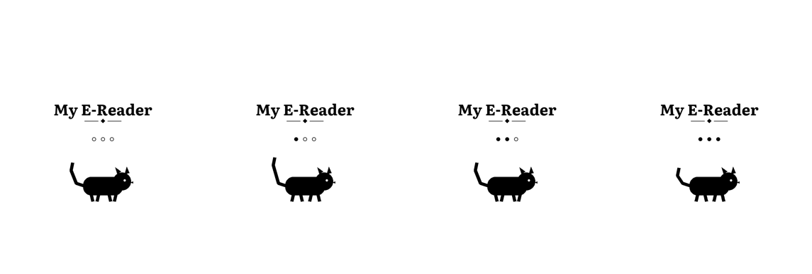

# 06 — Post-root Power Tweaks

What root actually buys you on this reader. Everything here is a **Magisk module** or a
**platform-signed RRO overlay** — systemless and removable. A script-only Magisk module (just
`module.prop` + a `post-fs-data.sh`/`service.sh`, no `system/` overlay) is very safe; replacing
`system/` files is riskier (see the `framework-res` warning in [04](04-sleep-screen.md)).

> **`su -c` gotcha (bit us repeatedly):** `adb shell su -c 'a; b; c'` runs only `a` as root — the
> host shell strips the quotes and `b; c` run as the non-root shell user (silent "Permission
> denied" on `/data`/`/system`). **Always push a script and run `su -c 'sh /data/local/tmp/x.sh'`.**

## E-ink refresh tuning

Two levers, both e-ink's biggest quality-of-life win:

- **Refresh mode** — vendor GUI: *Settings → Device Settings → Refresh Mode* (**Normal** = full
  quality/slight ghosting; **Fast** = text-optimized, snappier). It writes `persist.sys.mRefreshMode`
  (`132` = Normal, `2` = Fast). Live, no reboot.
- **Contrast** — *Settings → Device Settings → Global Contrast*.
- **Sharper text (root only)** — `persist.display.enhance_mode` (`0`→`1`). Lock it in with a tiny
  Magisk module so it reapplies every boot:

```
# /data/adb/modules/einktweaks/post-fs-data.sh
#!/system/bin/sh
resetprop persist.display.enhance_mode 1
```

> e-ink effects show only on the **physical panel** — `screencap` captures the framebuffer, not the
> panel output. And the sleep-logo is **cached**, so test refresh changes with natural sleep cycles,
> not rapid toggling.

## Block vendor telemetry

The one phone-home left after debloat is the vendor's install-info uploader. Disable the component:

```bash
adb shell su -c 'pm disable com.mgs.settings/.userdata.AppInfoService'
```

For full per-app internet control, install a root firewall (**AFWall+**) and whitelist only the
apps that need the net (browser, KOReader sync, F-Droid).

## System font swap

Replace Roboto system-wide with a Magisk module — put new `.ttf`s at the **same Roboto filenames**
so `fonts.xml` needs no edit. Map a 4-style font across Roboto's weights (100/300/400/500 →
Regular, 700/900 → Bold; + italics). [Atkinson Hyperlegible](https://github.com/googlefonts/atkinson-hyperlegible)
is a great legibility pick for e-ink.

```
/data/adb/modules/einkfont/system/fonts/Roboto-Regular.ttf   (= Atkinson Regular)
                                        /Roboto-Bold.ttf      (= Atkinson Bold)   ... etc
```

Set SELinux context after copying: `chcon -R u:object_r:system_file:s0 $MODULE/system`.
(Note: the stock `com.android.settings` crash is a pre-existing debloat issue, *not* the font.)

## Custom boot animation

Replace `/system/media/bootanimation.zip` via a Magisk module (`system/media/`). Format on this
device: **758×1024, 2 fps**, frames looped.

```
desc.txt:   758 1024 2
            p 0 0 part0
part0/00000.png 00001.png ...   (grayscale; keep it simple — e-ink flashes on each frame)
```

Build **STORED** (no compression): `zip -0 bootanimation.zip desc.txt part0/*` (or Python
`ZIP_STORED`). `scripts/render_boot.py` renders a branded logo + dot loader + a little walking cat.



## Framework overlay theming

A platform-signed static RRO (see [04](04-sleep-screen.md)) can override **any** framework
resource by name — colors, dimens, booleans, strings, drawables. Example: force UI accents black
for crisper controls:

```xml
<!-- res/values/colors.xml, targetPackage="android" -->
<color name="accent_device_default_light">#FF000000</color>
<color name="accent_device_default_dark">#FF000000</color>
```

Build/sign/install exactly like the sleep-screen overlay. **Honest note:** on a *grayscale* panel,
color overrides are subtle (the accent already renders dark) — *dimensions/layout/config* overlays
have more visible payoff than colors here.

## The module pattern

Each tweak is its own removable module/overlay, so you can disable any one independently:

| Module / overlay | What it does |
|---|---|
| `einktweaks` (module) | `enhance_mode=1` on every boot |
| `einkfont` (module) | Atkinson Hyperlegible system font |
| `bootanim` (module) | custom boot animation |
| `sleepoverlay` (/vendor/overlay) | rotating artwork lost-&-found sleep screen |
| `einktheme` (/vendor/overlay) | black UI accents |

Remove a module: `rm -rf /data/adb/modules/<id>` + reboot. Remove an overlay:
`rm /vendor/overlay/<name>.apk` (remount `/vendor` rw first) + reboot.
